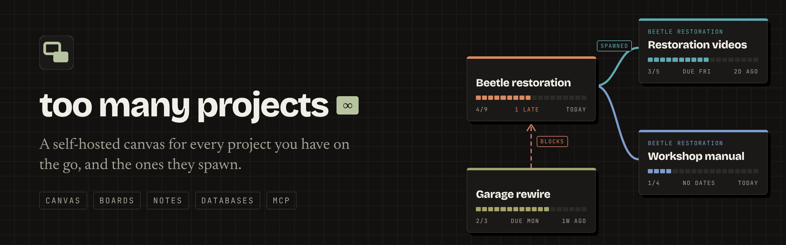
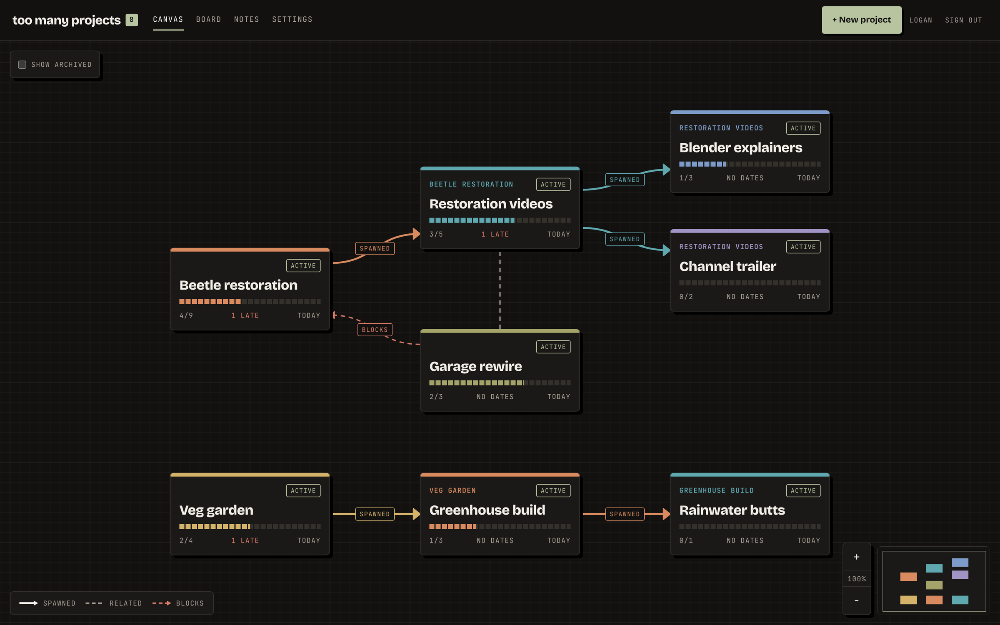
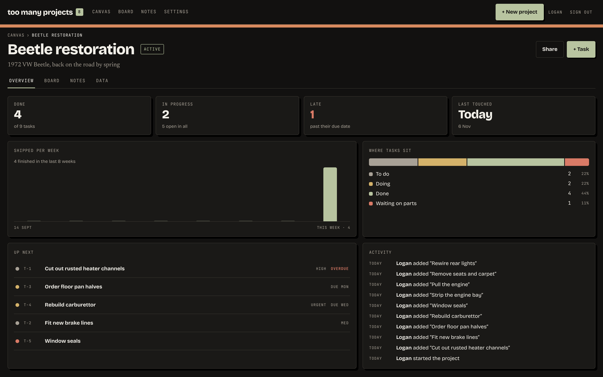
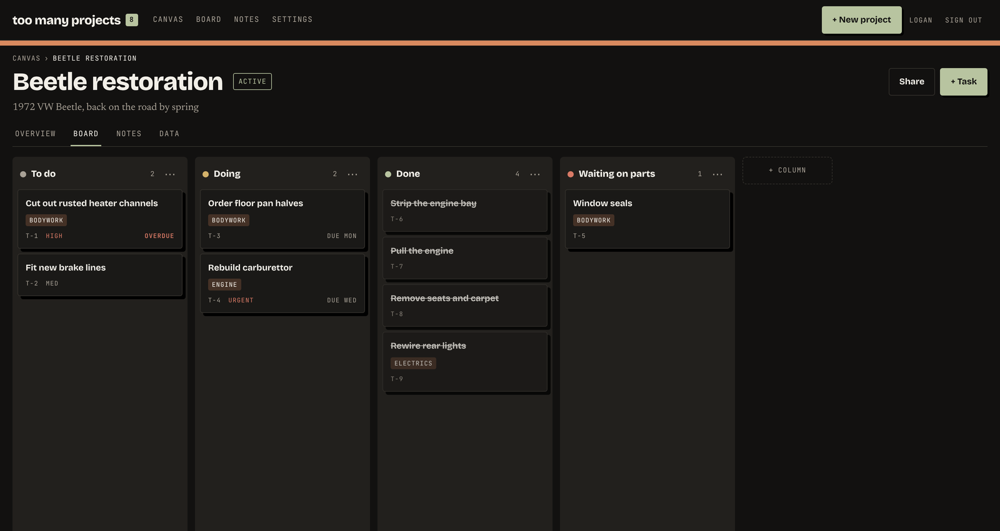
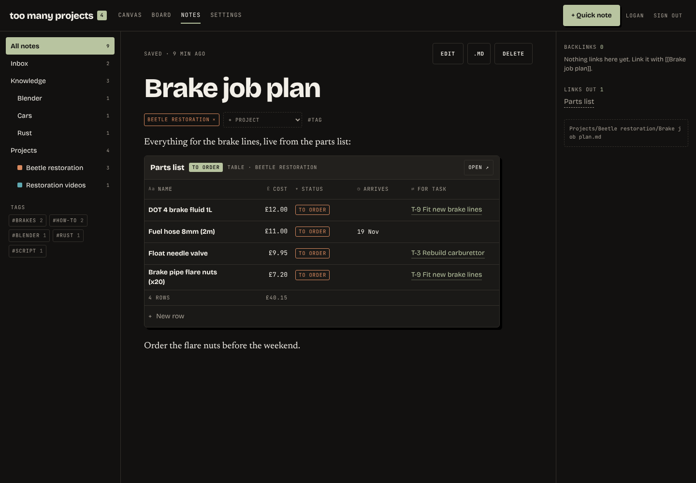
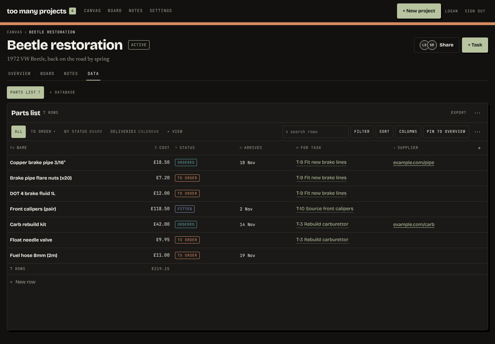
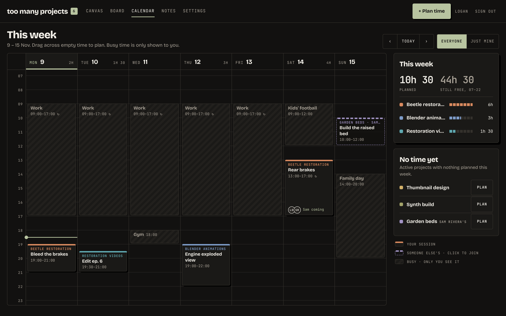
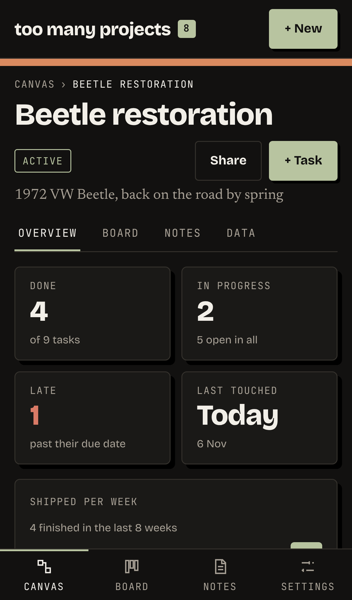
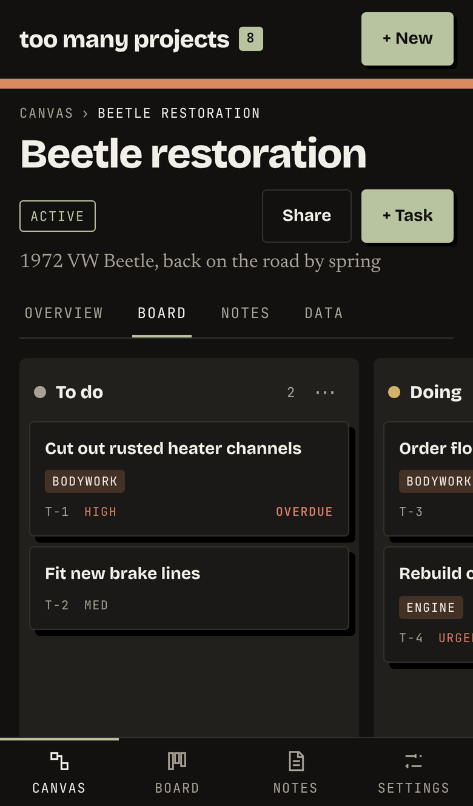
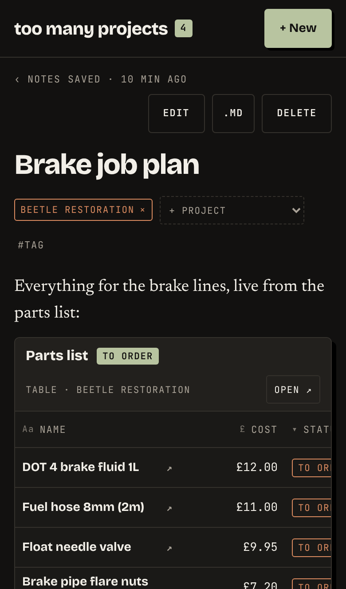

<p align="center">
  
</p>

<p align="center">
  <a href="https://github.com/IllusiveBagel/TooManyProjects/actions/workflows/ci.yml"></a>
  <a href="https://github.com/IllusiveBagel/TooManyProjects/releases"></a>
  <a href="https://github.com/IllusiveBagel/TooManyProjects/pkgs/container/toomanyprojects"></a>
  <a href="#ai-assistants-mcp"></a>
  
</p>

<p align="center">
  <a href="#features">Features</a> ·
  <a href="#quick-start">Quick start</a> ·
  <a href="#ai-assistants-mcp">AI assistants</a> ·
  <a href="docs/guide.md">User guide</a> ·
  <a href="docs/development.md">Development</a>
</p>

---

**too many projects** is a home for people who start more things than they
finish. Every project sits as a card on one infinite canvas. When a project
grows another one (a car restoration that turns into a video series that turns
into a set of Blender animations), the new card is joined to its parent with an
arrow, so you can see how everything you're doing fits together.

Click into any card for a proper dashboard: tasks, a kanban board, notes,
and tables of your own. It runs on your server as a single Docker container,
keeps your notes as plain markdown files, and lets an AI assistant read and
update your projects through MCP.

## Features

### 🗺️ One canvas for everything

Projects are cards showing live progress, late tasks and last activity.
Spawned projects hang off their parents, and *related* and *blocks* links show
what depends on what. Draw labelled, coloured groups round related cards
(electronics, cars, code) and drag a group to carry everything in it. Drag,
zoom, and lay it out however your head works.

<p align="center">
  
</p>

<table>
  <tr>
    <td width="50%" valign="top">
      <h3>📊 A dashboard for every project</h3>
      Open a card for its overview: what's done, what's late, what shipped
      each week, where tasks sit, what's up next and who changed what.
    </td>
    <td width="50%" valign="top">
      <h3>📋 Boards, per project and global</h3>
      Each project gets its own kanban columns. The global board folds every
      project into <em>to do</em>, <em>in progress</em>, <em>blocked</em> and
      <em>done</em>, filterable by project or a whole family of them. Every
      task keeps a log of comments and links to the notes it taught you.
    </td>
  </tr>
  <tr>
    <td valign="top">
      
    </td>
    <td valign="top">
      
    </td>
  </tr>
  <tr>
    <td width="50%" valign="top">
      <h3>📝 A notes vault you own</h3>
      Notes are markdown files on disk, so Obsidian can open the same folder.
      Wiki links, backlinks, tags, quick capture, and import from Obsidian or
      Notion.
    </td>
    <td width="50%" valign="top">
      <h3>🗃️ Databases inside projects</h3>
      Build a parts list, an episode tracker or a budget with typed columns,
      then view it as a table, board or calendar. Embed live views in notes and
      link rows to tasks.
    </td>
  </tr>
  <tr>
    <td valign="top">
      
    </td>
    <td valign="top">
      
    </td>
  </tr>
</table>

### 📅 A week to give projects real time

Plan work sessions on projects, block out time you can't use (work 9 to 5 on
weekdays, a busy Saturday) with weekly repeats, and see how many free hours
are left and which active projects got no time at all. Friends you share a
project with see its sessions and can say they'll join.

<p align="center">
  
</p>

And the rest:

- **📷 Photos and files.** Snap progress from your phone onto a task or a log
  entry, drop in PDFs, STLs and receipts, and read each project's **Photos**
  tab as a build log, week by week. Files stay on your own disk.
- **🤝 Sharing.** Invite-only accounts. Share one project (and what it
  spawns) or everything, as *Can edit* or *View only*, and assign tasks to
  each other.
- **🤖 AI assistants.** A built-in [MCP](https://modelcontextprotocol.io)
  server gives Claude and other assistants a briefing on any project and your
  calendar, and can create tasks, notes, rows and sessions. Connect Claude
  by signing in: no tokens to copy.
- **📱 Works on your phone.** Every screen has a phone layout with bottom tabs
  and full-screen drawers.
- **🎨 Themeable.** Every colour, font and shadow comes from one theme file.
  The default *Workshop* theme has dark and light *Paper* modes.
- **📦 Easy to run and back up.** One container, SQLite, no external services.
  Everything lives in one `/data` folder.

<p align="center">
  
  &nbsp;
  
  &nbsp;
  
</p>

## Quick start

Each release is published as a Docker image at
`ghcr.io/illusivebagel/toomanyprojects`. On your server, save
[`docker-compose.yml`](docker-compose.yml), set `TMP_PUBLIC_URL` in it to the
address you'll open the app at, then:

```sh
docker compose up -d
```

Open <http://localhost:8080>. The first person to open a new install creates
the **owner** account. After that, people join only through invite links the
owner makes under **Settings → Invites**.

To upgrade, `docker compose pull && docker compose up -d`. The owner sees a
banner in the app when a new release is out (see
[Updating](docs/guide.md#updating)). To build the image
from source instead, run `docker build -t ghcr.io/illusivebagel/toomanyprojects .`
in a clone of this repo.

> [!TIP]
> Everything the app stores lives in the `/data` volume: the SQLite database,
> the theme files and everyone's notes. Back up that one folder and you have
> backed up everything.

### Configuration

| Variable | Default | What it does |
| --- | --- | --- |
| `TMP_PUBLIC_URL` | unset | The address people reach the app at, such as `https://projects.example.com`. Used for invite links and for connecting Claude by signing in, which needs a public `https://` address (see [Put it online with HTTPS](docs/guide.md#put-it-online-with-https)). When it starts with `https://`, session cookies are marked secure. |
| `TMP_COOKIE_SECURE` | from `TMP_PUBLIC_URL` | Force secure cookies on (`true`) or off (`false`). |
| `TMP_SESSION_DAYS` | `30` | How long a sign-in lasts. |
| `TMP_DATA_DIR` | `/data` in Docker | Where the database, themes and notes live. |
| `TMP_MAX_UPLOAD_MB` | `25` | Largest photo or file you can attach. |
| `TMP_BIND` | `0.0.0.0:8080` | Address and port to listen on. |
| `TMP_HTTPS` | `0.0.0.0:8443` | Where the app serves HTTPS with its own certificate, for Claude Code on your network (see [HTTPS on your home network](docs/guide.md#https-on-your-home-network)). `off` turns it off. |
| `TMP_TLS_HOSTS` | unset | Extra names or IPs the app's certificate covers, comma separated, such as `192.168.1.50,nas.local`. More can be added in Settings → HTTPS. |
| `TMP_TLS_CERT`, `TMP_TLS_KEY` | unset | Serve your own certificate (full chain) and key instead of the app's. |
| `TMP_UPDATE_CHECK` | `on` | Set to `off` to stop the server asking GitHub for new releases, such as on an offline server. |
| `RUST_LOG` | `toomanyprojects=info` | Log level. |

Put the app behind your usual reverse proxy for HTTPS, or follow
[Put it online with HTTPS](docs/guide.md#put-it-online-with-https) for a
Cloudflare Tunnel, Tailscale Funnel or Caddy setup.

## AI assistants (MCP)

The server speaks the Model Context Protocol at `/mcp`, and you connect Claude
by signing in. Copy the address from **Settings → AI access**, add it in
Claude under **Settings → Connectors → Add custom connector**, then sign in
and press **Allow**. Claude Code works the same way:

```sh
claude mcp add --transport http toomanyprojects https://your-host/mcp
```

then `/mcp` → **Authenticate**. The Claude app connects from the internet, so
it needs a public `https://` address
([how to set one up](docs/guide.md#put-it-online-with-https)). API tokens are
still there for scripts.

Your assistant can then list and search projects, pull a full briefing on one,
read notes and a task's log, query databases and, with read-write access, add
tasks, comments, notes and rows or spawn new projects. Anything it changes is marked *via AI* in the
project's activity. The [user guide](docs/guide.md#ai-access-mcp) has the full
list of tools, resources and prompts.

## Documentation

- **[User guide](docs/guide.md):** boards, calendar, notes, photos and files, sharing, databases, AI access
  and theming, in detail.
- **[Development](docs/development.md):** running it locally, the checks CI
  runs, the code layout, and how releases are made.

## Built with

[Rust](https://www.rust-lang.org) and [Axum](https://github.com/tokio-rs/axum)
with [SQLx](https://github.com/launchbadge/sqlx) on SQLite for the server;
[React 19](https://react.dev), TypeScript, [Vite](https://vite.dev),
[Tailwind v4](https://tailwindcss.com), [React Flow](https://reactflow.dev),
[dnd-kit](https://dndkit.com) and [CodeMirror 6](https://codemirror.net) for
the web app. The API is described with OpenAPI and the web client's types are
generated from it.
